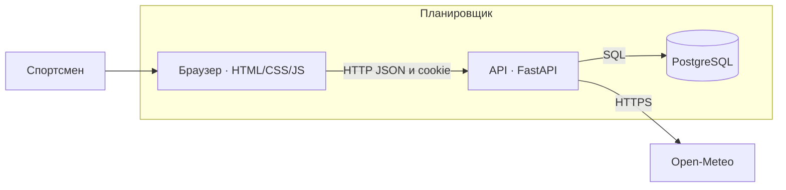
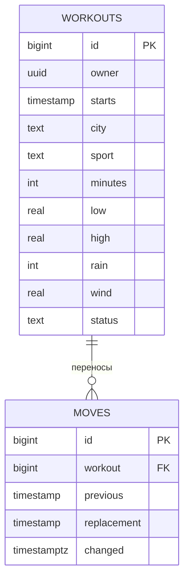
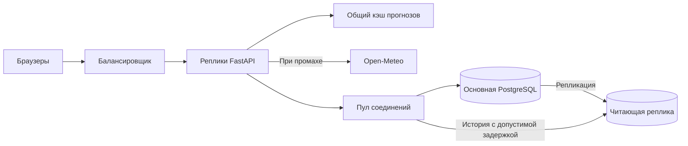

# Веб-планировщик тренировок на улице с учётом прогноза погоды

Курсовой проект команды из трёх человек. 

## Проблема

Тем, кто тренируется на улице, приходится вручную сверять расписание тренировок с почасовым прогнозом. Если на выбранное время обещают дождь или сильный ветер, поиск другого времени приходится повторять.

## Первая версия

1. Пользователь добавляет тренировку в календарь, указывая город, вид тренировки, дату, время и длительность.
2. Пользователь задаёт подходящий диапазон температуры, максимальную вероятность осадков и скорость ветра. Карточка тренировки показывает почасовой прогноз. Если условия не подходят, сервис предлагает ближайшее подходящее окно той же длительности в тот же день, когда такое окно есть в прогнозе. Перенос сохраняется после подтверждения пользователя.
3. После тренировки пользователь отмечает её выполненной или отменённой. В истории видны статус и переносы.

## Стек

- **Сервер** — Python и FastAPI.
- **База данных** — PostgreSQL для тренировок, настроек и истории переносов.
- **Веб-интерфейс** — HTML, CSS и JavaScript.
- **Внешняя интеграция** — Open-Meteo API для почасового прогноза.
- **Сборка и запуск** — Docker Compose.

## Запуск и проверка

В корне проекта выполните `docker compose up --build -d`. Откройте http://localhost:8000. Для остановки выполните `docker compose down`. Именованный том сохраняет базу между запусками. Для тестов выполните `docker compose exec web python -m pytest -q`. GitHub Actions повторяет сборку, HTTP-проверку и тесты в отдельной базе при каждом push.

Календарь привязан к случайному идентификатору в cookie браузера. Удаление cookie открывает новый календарь. Выберите один из четырёх городов, время по Москве в ближайшие семь дней и пределы погоды. Откройте «Прогноз» на карточке тренировки. Сервер проверяет каждый затронутый час и предлагает ближайшее подходящее начало на границе часа. При равном расстоянии выбирается более раннее время. При неполном прогнозе приложение сообщает об этом. Перед переносом сервер проверяет актуальность предложения. Сохранение нового времени и запись истории проходят в одной транзакции.

## Команда

| Участник | ФИО и группа | Предлагаемая зона работы |
|---|---|---|
| 1 | Заполнить | Календарь и интерфейс |
| 2 | Заполнить | API и PostgreSQL |
| 3 | Заполнить | Прогноз, подбор времени и тесты |

## Архитектура

### C4. Контекст

### C4. Контейнеры

### Данные

## Расчётная нагрузка

Учебная оценка для 10 000 пользователей в сутки при 12 чтениях и 2 изменениях на человека даёт 120 000 чтений и 20 000 записей в сутки (6 к 1). Средняя нагрузка 1,62 запроса/с, при десятикратном внутрисуточном пике около 16 запросов/с. При среднем ответе 4 КБ и запросе 0,5 КБ трафик API около 630 МБ/сутки без статики и запросов к поставщику. Кэш прогноза в процессе обслуживает повторные обращения по городу и дате в течение 15 минут.

Горизонт хранения — 6 лет. При 5 000 новых тренировок и 2 000 переносов ежедневно получится около 11 млн тренировок и 4,4 млн переносов. При бюджетах 500 и 200 байт на запись с индексами это около 6,4 ГБ. С тройным запасом под рост и обслуживание нужен том около 20 ГБ плюс отдельное место для резервных копий. Индекс по владельцу и времени обслуживает сортировку календаря, индекс по идентификатору тренировки — чтение истории. Эти оценки требуют проверки нагрузочным тестом. Для пользователей с большой историей при росте потребуется постраничная выдача.

### Рост аудитории в 10 раз

При 100 000 пользователей в сутки расчётный пик составит около 162 запросов/с. Сразу после переноса клиент должен читать календарь из основной БД. Кэш и реплика относятся к проекту масштабирования.

## Контракты API и время отклика

Интерактивные схемы запросов и ответов доступны по адресу /docs, машиночитаемый контракт — /openapi.json. Все даты тренировок передаются в местном времени выбранного города (МСК). Целевые значения p95 при расчётном пике — 300 мс для операций с БД, 500 мс для прогноза из кэша, 3 с при запросе к поставщику. Это цели проектирования.

| Метод и путь | Результат |
|---|---|
| GET /api/session | Открыть календарь, получить города и дату |
| POST /api/workouts | Создать тренировку и получить id (201) |
| GET /api/workouts | Список тренировок с датой и статусом |
| GET /api/workouts/{id}/forecast | Почасовые значения [°C, вероятность осадков в %, ветер в км/ч], пригодность и предложенное время |
| POST /api/workouts/{id}/move | Принять предложение с previous и replacement, вернуть новое время |
| PUT /api/workouts/{id}/status?value=done или cancelled | Зафиксировать статус |
| GET /api/workouts/{id}/history | Получить старое и новое время каждого переноса |

Коды ошибок включают 401 для отсутствующего календаря, 404 для недоступной записи, 409 при устаревшем предложении, 422 для неверных полей и 503 при сбое прогноза.

## Тестирование

Три модульных теста проверяют условия на всей длительности тренировки, пропуск часа и отсутствие подходящего окна. Интеграционный тест использует FastAPI и настоящую PostgreSQL с воспроизводимым прогнозом. Он создаёт пробежку, принимает перенос, проверяет запись в календаре и истории, повторное подтверждение, смену статуса и изоляцию календарей.
